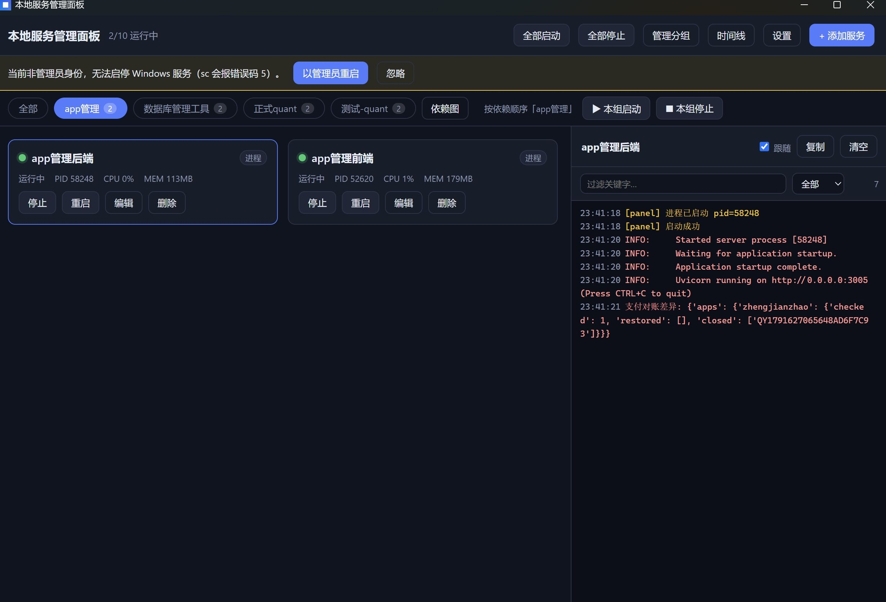

# Service Panel · 本地服务管理面板

一个桌面小工具，把你本机所有开发服务和中间件（Python / Node / Go / Java / Rust 进程，MySQL / Redis，Docker 容器）集中到一个面板里，一键启动 / 停止 / 重启，看实时日志，崩溃自动拉起。**解决"每次开机要一个个手动开服务"的麻烦。**

---

## 效果预览


<--  -->

界面：卡片式服务列表（状态灯 + CPU/内存）、右侧实时日志栏、分组标签栏与依赖图、系统托盘菜单。

---

## 快速开始

### 第 0 步：装环境依赖

需要三样东西：**Rust 工具链（rustup，≥1.77）**、**Node.js 18+**、**平台 C++ 构建工具**。装完**重开一个终端**再执行下面的验证命令。

**Windows（PowerShell）**

```powershell
# 1) Visual Studio Build Tools（必须勾选 C++ 工作负载，rustc 的 MSVC 后端和 rusqlite 都依赖 link.exe/cl.exe）
winget install Microsoft.VisualStudio.2022.BuildTools --override "--wait --quiet --add Microsoft.VisualStudio.Workload.VCTools --includeRecommended"

# 2) Rust 工具链（默认 host=x86_64-pc-windows-msvc，别装 GNU 版）
winget install Rustlang.Rustup

# 3) Node.js LTS
winget install OpenJS.NodeJS.LTS

# 4) WebView2 运行时（Win11 和较新的 Win10 已随 Edge 内置；缺了才需要装）
winget install Microsoft.EdgeWebView2Runtime
```

> 第 1 步若 winget 的 `--override` 不生效（公司网/已装过），就打开"Visual Studio Installer → 修改 → 单个组件/工作负载"，手动勾选**「使用 C++ 的桌面开发」**，至少包含 MSVC v143 生成工具 + Windows 10/11 SDK。

**macOS**

```bash
xcode-select --install                                  # clang + 系统框架
curl --proto '=https' --tlsv1.2 -sSf https://sh.rustup.rs | sh   # Rust
brew install node                                       # Node.js
# 然后重开终端，或执行：source "$HOME/.cargo/env"
```

**Linux（Debian / Ubuntu）**

```bash
sudo apt update
sudo apt install -y libwebkit2gtk-4.1-dev build-essential curl wget file \
                    libxdo-dev libssl-dev libayatana-appindicator3-dev librsvg2-dev
curl --proto '=https' --tlsv1.2 -sSf https://sh.rustup.rs | sh
# Node.js 建议用 nvm：https://github.com/nvm-sh/nvm
nvm install --lts
```

其它发行版（Fedora/Arch）按 Tauri 官方依赖清单安装，关键字：`webkit2gtk-4.1`、`libappindicator`、`libxdo`、`openssl-devel`。

**国内网络加速（可选，卡在下载时才需要）**

```bash
# crates.io 换镜像（写入 ~/.cargo/config.toml，全局生效）
mkdir -p ~/.cargo
cat >> ~/.cargo/config.toml <<'EOF'
[source.crates-io]
replace-with = 'rsproxy-sparse'
[source.rsproxy-sparse]
registry = "sparse+https://rsproxy.cn/index/"
EOF

# rustup 自身下载源换镜像（PowerShell 用 $env: 语法）
export RUSTUP_DIST_SERVER="https://rsproxy.cn"
export RUSTUP_UPDATE_ROOT="https://rsproxy.cn/rustup"
```

**验证环境（四行都要有输出再进下一步）**

```bash
rustc -V && cargo -V && node -v && npm -v
```

### 第 1~3 步：装依赖、运行、打包

```bash
cd service-panel

# 1) 安装前端依赖（国内网络建议用镜像源）
npm install --registry=https://registry.npmmirror.com

# 2) 开发运行（首次会编译全部 Rust 依赖，5~15 分钟属正常，之后增量很快）
npm run tauri dev

# 3) 打包安装包（产物在 src-tauri/target/release/bundle/）
npm run tauri build
```

要管 Windows 系统服务需管理员权限：开发时用**管理员终端**跑 `npm run tauri dev`。

---

## 功能特性

- **三类服务统一管理**：命令行进程、系统服务（Windows 服务 / systemd / launchd）、Docker 容器，一套界面。
- **可靠启停**：停止时回收整棵进程树（Windows 用 Job Object，Linux/macOS 用进程组），不留孤儿进程占端口；面板自身崩溃时，Linux/macOS 由随服务拉起的轻量看门狗进程补刀回收。
- **健康检查 + 崩溃自愈**：TCP/HTTP/命令探活，异常按指数退避自动重启，用户手动停止不会被误拉起。
- **依赖拓扑一键启停**：给服务设依赖，分组按拓扑顺序"起一个、等它健康再起下一个"，停止逆序，并有 SVG 依赖图可视化。
- **开机自启 + 托盘常驻**：登录后台自启、按依赖拉起勾选的服务；关闭窗口收进托盘。
- **实时日志与观测**：stdout/stderr/Docker/文件尾随统一展示，支持关键字过滤、自动编码（UTF-8/GBK）、事件时间线、资源占用。

---

## 使用示例

在面板「+ 添加服务」里按下表填（类型都是"命令行进程"）：

| 场景 | 启动命令 | 参数 | 工作目录 | 健康检查 |
|---|---|---|---|---|
| Node 前端 | `npm` | `run dev` | 前端项目根 | HTTP `http://localhost:5173` |
| Java jar | `java` | `-jar target/app.jar` | jar 上级目录 | TCP `127.0.0.1:8080` |
| Python (conda) | `C:\...\envs\myenv\python.exe` | `-m uvicorn app.main:app --port 8000` | 项目根 | TCP `127.0.0.1:8000` |
| Rust 编译产物 | `D:\path\target\release\myapp.exe` | （空） | exe 目录 | 按需 |
| Docker 容器 | 类型选 Docker | 容器名 `mysql-dev` | — | 自动 |

要点：conda 环境**别用 `conda activate`**，直接用该环境的 `python.exe` 绝对路径；`npm`/`java` 这类在 Windows 上是 `.cmd`，面板会自动回退 `cmd /C` 执行。

---

## 技术栈

| 层 | 选型 |
|---|---|
| 桌面框架 | Tauri 2（Rust 后端 + 系统 WebView） |
| 前端 | React 18 + TypeScript + Vite 5 |
| 存储 | SQLite（`rusqlite`，bundled） |
| 进程/系统 | 原生 `std::process` + Windows Job Object / unix 进程组；`sysinfo` 采资源 |
| 关键库 | `chrono` `uuid` `encoding_rs` `base64`；插件 `autostart` `single-instance` `dialog` |

配置与数据存放：`%APPDATA%\com.local.servicepanel\`（Windows）下 `data/panel.db` 与 `logs/<服务id>/*.log`。

---

## 目录结构

```
service-panel/
  src/                 React 前端
    App.tsx            主布局 + 事件订阅 + 轮询
    types.ts           与 Rust 对齐的类型
    lib/               api（invoke/事件）、deps（拓扑）
    components/        ServiceCard / LogConsole / AddServiceDialog
                       GroupManagerDialog / SettingsDialog / DependencyGraph / EventsDialog
  src-tauri/src/       Rust 后端
    drivers/           command / winservice(systemd·launchd·sc) / docker
    manager.rs         启停编排 + 生命周期互斥锁
    guard.rs           unix 看门狗：面板崩溃后由它 kill(-pgid) 兜底
    supervisor.rs      监督线程：崩溃检测、健康、重启退避、资源采样
    group.rs           分组拓扑排序（Kahn）+ 按序启停
    health.rs          TCP / HTTP / 命令 健康检查
    logs.rs / logsrc.rs 日志管线与外部服务日志接入
    secrets.rs         配置加密（Windows DPAPI，其它平台明文）
    winjob.rs / elevate.rs  Windows 专属：Job Object、提权探测
    commands.rs / lib.rs   Tauri 命令与装配
  scripts/gen_icons.mjs  生成占位图标
  docs/PUBLISH.md      发布与 Git 工作流教程
```

---

## 配置说明

**每个服务（spec）**：`driver`（command/windows_service/docker）、`command` + `args` + `cwd` + `env`、`encoding`（auto/utf-8/gbk）、`stopTimeoutSecs`（优雅停止超时）、`healthcheck`（kind + target + interval + 失败阈值）、`restartPolicy`（never/on_failure/always + 最大重试 + 退避基数）、`after`（依赖的服务 id）、`logPath`（尾随的外部日志文件）。

**全局**：开机自启（设置里开关）；前端 dev 端口固定 `5273`（`vite.config.ts` 与 `tauri.conf.json` 两处，改端口要同时改）；日志保留 7 天、单文件 20MB 滚动；事件表保留 7 天 / 上限 5000 行。

---

## 常见问题 FAQ

- **端口 5173/5273 被占用**：本项目用 5273；仍冲突就同时改 `vite.config.ts` 的 `port` 和 `tauri.conf.json` 的 `devUrl`。
- **`npm install` 卡住 / esbuild 报错**：用镜像源 `--registry=https://registry.npmmirror.com`；esbuild 被拦时 `npm install-scripts approve esbuild && npm rebuild esbuild`。
- **Tauri 版本 mismatch**：`@tauri-apps/api`/`cli` 的 minor 必须和 Rust `tauri` crate 一致，别只升一边。
- **管 Windows 服务报权限错误码 5**：需管理员。开发模式用**管理员终端**跑 `npm run tauri dev`（别点应用内"以管理员重启"，那是给打包版用的）；详见 `docs/PUBLISH.md` 与设置面板提示。
- **工作目录带空格导致 `os error 267`**：已自动 trim 命令/参数/目录首尾空格。
- **Python 日志中文乱码**：输出编码选"自动"，或给服务加环境变量 `PYTHONUTF8=1`。
- **conda 服务起不来**：不要用 `conda activate`，直接用环境里的 `python.exe` 绝对路径。
- **偶尔突然退出（exit code 0xe0000008）**：崩溃现场已写入 `%APPDATA%\com.local.servicepanel\panic.log`，看它定位真因。
- **跨平台**：核心功能三平台可用；Windows 为完整支持目标，Linux/macOS 的进程树回收与服务驱动为跨平台实现（首次请在真机 `cargo build` 验证）。

---

## 许可

MIT（可按需调整）。
